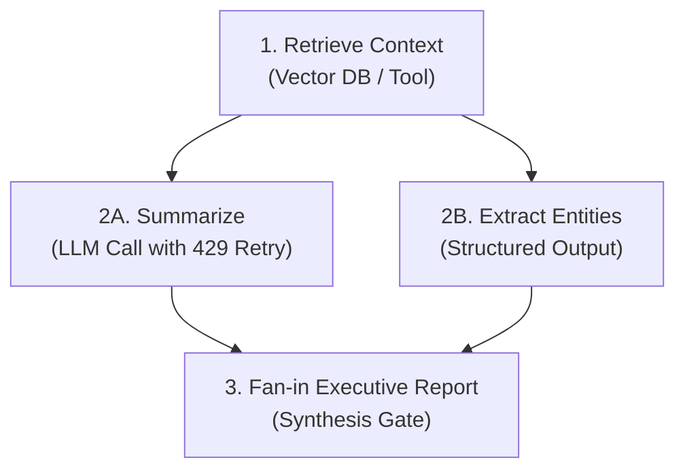
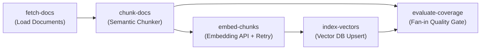
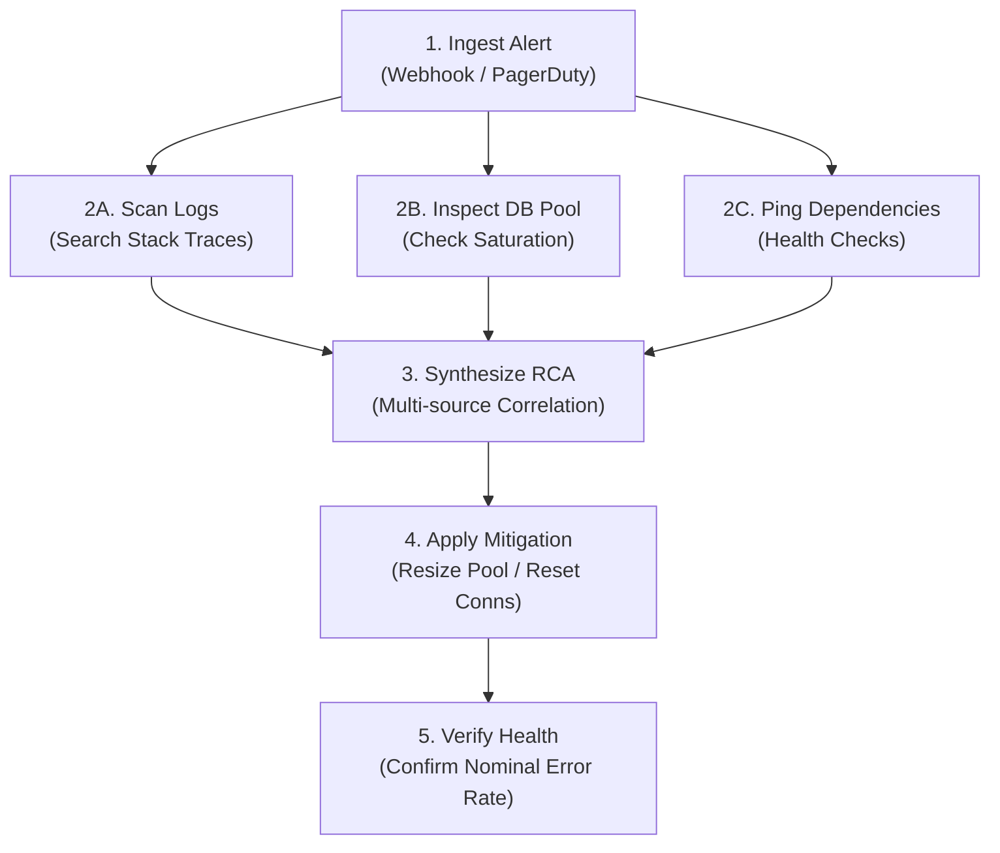
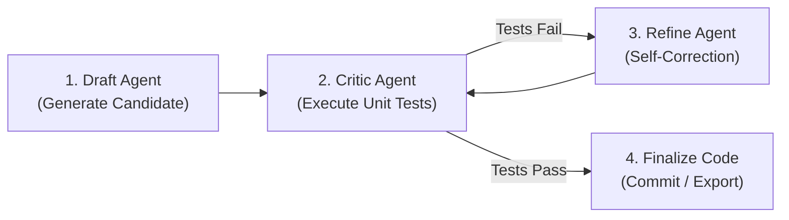
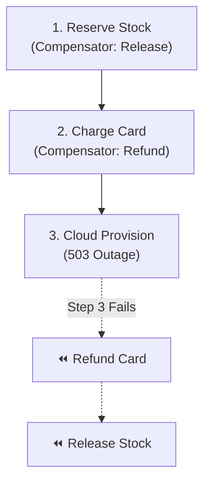

# Real-World Use Cases

The **Orchestration Engine** is designed to provide zero-dependency, fault-tolerant execution for workflows where steps depend on each other, fail transiently, and require an auditable history.

Below are core production architectures implemented using the engine.

---

## 1. Multi-Step AI Agent Pipelines

**Example Implementation:** [`examples/agent_pipeline.py`](https://github.com/Reddirector/Orchestration_Engine/blob/main/examples/agent_pipeline.py)

Modern AI agent workflows often comprise multiple stages: knowledge retrieval, model inference, tool execution, critique/verification, and final synthesis.



### Key Engineering Patterns
- **Transient Provider Retries:** LLM APIs commonly return `HTTP 429 (Too Many Requests)` or `503 (Overloaded)`. Configured `RetryPolicy(max_attempts=3, delay_seconds=1.0)` retries with exponential backoff.
- **Concurrent Fan-Out:** Independent steps (e.g., entity extraction and narrative summarization) run concurrently via `max_concurrency=2`.
- **Data Flow:** Step outputs (`TaskResult(ok=True, output=...)`) are stored in SQLite and automatically injected into downstream tasks via `task.inputs`.
- **Crash Recovery:** If the agent host terminates abruptly mid-run, `resume_run(conn, run_id, ...)` resumes execution without re-executing completed tasks.

---

## 2. RAG Document Ingestion & Vector Indexing

**Example Implementation:** [`examples/rag_document_indexer.py`](https://github.com/Reddirector/Orchestration_Engine/blob/main/examples/rag_document_indexer.py)

Building retrieval-augmented generation (RAG) indexes requires ingesting source documents, chunking text, computing vector embeddings, and indexing them into a vector database with strict quality verification.



### Key Engineering Patterns
- **Structured Data Propagation:** The chunker splits documents and passes structured chunks downstream via `task.inputs["fetch-docs"]`.
- **API Backpressure Mitigation:** Embedding models frequently impose tight token rate limits. Automatic retry policies ensure zero lost data during network or provider hiccups.
- **Fan-in Evaluation Gate:** `evaluate-coverage` compares the count of chunks produced by `chunk-docs` against the count of embeddings stored by `index-vectors`, validating indexing health before marking the workflow succeeded.

---

## 3. Automated Incident Triage & Remediation (DevOps / SRE)

**Example Implementation:** [`examples/incident_triage.py`](https://github.com/Reddirector/Orchestration_Engine/blob/main/examples/incident_triage.py)

Autonomous incident response systems must ingest alerts, run parallel diagnostics across different telemetry backends, synthesize a root-cause analysis (RCA), execute automated remediation, and verify recovery.



### Key Engineering Patterns
- **High Concurrency Diagnostics:** Runs parallel checks against logs, metrics, and microservices simultaneously (`max_concurrency=3`).
- **Multi-Source Correlation:** `synthesize-rca` aggregates diagnostic data from all 3 independent branches to isolate the true root cause.
- **Fail-Safe Transitive Cancellation:** If automated mitigation fails, dependent verification steps are automatically `CANCELLED`, preventing premature incident closure.
- **Real-Time SRE Notifications:** User-supplied `Hooks` notify operations channels (e.g. Slack, PagerDuty) upon step transition or retry without blocking the coordinator.

---

## 4. Resilient ETL & Data Processing Pipelines

**Example Implementation:** [`examples/builder.py`](https://github.com/Reddirector/Orchestration_Engine/blob/main/examples/builder.py) and [`examples/data_flow.py`](https://github.com/Reddirector/Orchestration_Engine/blob/main/examples/data_flow.py)

Data pipelines requiring strict transactional guarantees, schema migration, and zero data loss.

### Key Engineering Patterns
- **Fluent Declarative Construction:** Construct complex DAGs cleanly with `WorkflowBuilder`:
```python
workflow = (
    WorkflowBuilder("etl-pipeline", default_timeout_seconds=30.0)
    .task("extract", timeout_seconds=10.0)
    .task("transform", dependencies=["extract"], max_attempts=3)
    .task("load", dependencies=["transform"])
    .build()
)
```
- **Portable Serialization:** Round-trip workflows to JSON/YAML dictionaries via `workflow_to_dict()` and `load_workflow_from_json()`.
- **Transactional State Persistence:** SQLite write-ahead logging (WAL) logs all task events (`task_events`) and payloads (`task_outputs`) atomically.

---

## 5. Agentic Self-Correction & Reflection Loops

**Example Implementation:** [`examples/agentic_state_graph.py`](https://github.com/Reddirector/Orchestration_Engine/blob/main/examples/agentic_state_graph.py)

Autonomous code synthesis and LLM agentic reasoning pipelines require cyclical execution loops: draft code, run test suite, critique failures, and self-correct until all assertions pass or maximum bounds are reached.



### Key Engineering Patterns
- **Cyclic State Graph Topology:** Uses `StateGraph` and `CompiledStateGraph` with `START` and `END` nodes, bypassing standard DAG acyclic restrictions.
- **Dynamic Conditional Branching:** Transitions choose next nodes dynamically based on reflection evaluation (`add_conditional_edges`).
- **Thread-Scoped SQLite Checkpointing:** `StateCheckpointer` records intermediate agent memory state across reflection iterations, allowing full post-mortem inspection.
- **Strict Guardrail Bounds:** `max_iterations` prevents runaway infinite loops when agents encounter unsolvable constraints.

---

## 6. Distributed Sagas & Compensating E-Commerce Transactions

**Example Implementation:** [`examples/event_driven_idempotency.py`](https://github.com/Reddirector/Orchestration_Engine/blob/main/examples/event_driven_idempotency.py)

Multi-service financial transactions—such as inventory reservation, payment charging, and cloud license provisioning—cannot rely on traditional distributed 2-phase commit (2PC). Sagas guarantee eventual consistency by executing backward compensating actions if any downstream step fails.



### Key Engineering Patterns
- **Backward Rollback Ordering:** When a failure occurs, registered compensating transactions execute in reverse topological order (`run_saga`).
- **Distributed Idempotency Keys:** `IdempotencyStore` guarantees that retry attempts never duplicate credit card charges or double-book stock.
- **Run-Scoped Blackboard:** `WorkflowBlackboard` provides atomic Compare-And-Swap (CAS) and increment counters for cross-task state sharing.
- **Business SLA Deadlines:** `SLAMonitor` tracks fulfillment deadlines, triggering alerts at 75% elapsed time and escalation upon breach.

---

## 7. Zero-Memory High-Volume Event Streaming

**Example Implementation:** [`examples/streaming_pipeline.py`](https://github.com/Reddirector/Orchestration_Engine-main/examples/streaming_pipeline.py)

Pipelines processing millions of log entries or sensor metrics without running out of RAM.

### Key Engineering Patterns
- **Generator Stream Processing:** `StreamPipe` and `run_streaming_pipeline` process data chunk-by-chunk in $O(1)$ memory.
- **SQLite Spill-to-Disk Backpressure:** When downstream consumers process events slower than upstream producers, excess events automatically spool to an SQLite ring buffer rather than filling process RAM.
- **POSIX Resource Quotas:** Worker stages can be decorated with `@sandboxed(max_memory_mb=64)` to strictly prevent memory leaks from crashing the host process.

